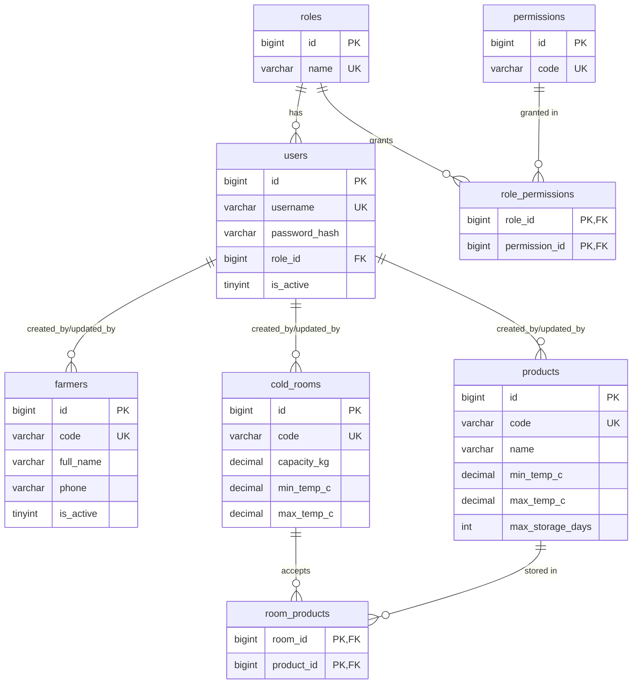

# ERD v1: auth and master data

Next migrations (40-50%+): entries, entry_details, stock_lots, stock_allocations, stock_movements,
transfers, exits, exit_details, exit_allocations, invoices, payments, temperature_logs, inspections,
damaged_stock_cases, notifications, audit_logs, facility_plans.
